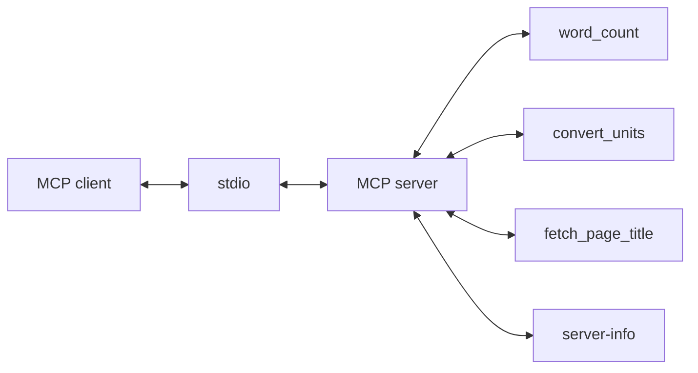

# mcp-server-demo

A small [Model Context Protocol](https://modelcontextprotocol.io) server written in TypeScript. It speaks MCP over stdio, so a local client such as Claude Desktop or the MCP Inspector can launch it as a child process and call three example tools: counting words, converting a few units, and reading the title of a web page.

## Architecture



The client sends JSON-RPC on stdin and reads responses from stdout. The server registers each tool with a Zod input schema and validates arguments before the handler runs. One static resource, `info://server`, describes the server. Diagnostic logs go to stderr so they stay out of the protocol stream.

## Tools

| Tool | What it does | Arguments |
| --- | --- | --- |
| `word_count` | Counts words, Unicode characters, non-whitespace characters, and lines. | `text` (string) |
| `convert_units` | Converts a number within length, weight, or temperature. | `value` (number), `from` (string), `to` (string) |
| `fetch_page_title` | Fetches an http(s) URL and returns the document title, final URL, and status code. | `url` (string), `timeoutMs` (optional integer, 100–15000, default 8000) |

`convert_units` accepts `mm`, `cm`, `m`, `km`, `in`, `ft`, `yd`, `mi`; `mg`, `g`, `kg`, `oz`, `lb`; and `C`, `F`, `K`, plus ordinary names such as `meter` and `pound`. Units from different categories are rejected.

`fetch_page_title` allows only `http` and `https`. It rejects loopback, link-local, and private addresses, and names that resolve to those addresses, including on redirects. The request aborts at the timeout. Body reading stops at the title element or at 64 KiB, and those bytes are decoded with the charset on the Content-Type header, or UTF-8 when the header does not name one. The check uses the addresses returned for that lookup; it does not re-check if DNS changes before the connection is made.

The `server-info` resource at `info://server` returns the server name, version, and tool list as JSON.

## Quick start

Requires Node.js 20 or newer.

```bash
npm install
npm run build
npm test
npm start
```

`npm start` runs `node dist/index.js` and waits on stdin for a client. To open the server in MCP Inspector:

```bash
npx @modelcontextprotocol/inspector node dist/index.js
```

`npm run dev` runs the TypeScript entry with `tsx`, without a separate build. `npm test` runs the Vitest unit tests. `npm run build` compiles `src/` to `dist/`.

## Claude Desktop

Add the server to the Claude Desktop config file: `~/Library/Application Support/Claude/claude_desktop_config.json` on macOS, or `%APPDATA%\Claude\claude_desktop_config.json` on Windows. Use the absolute path to `dist/index.js`.

```json
{
  "mcpServers": {
    "demo": {
      "command": "node",
      "args": ["/absolute/path/to/mcp-server-demo/dist/index.js"]
    }
  }
}
```

Restart Claude Desktop after saving the file.

## Project structure

```
src/
  index.ts                 stdio entry point
  server.ts                creates the MCP server and registers tools
  tools/word-count.ts
  tools/convert-units.ts
  tools/fetch-page-title.ts
tests/                     unit tests for the tool functions, plus a client smoke test
```

## Adding a tool

1. Add `src/tools/your-tool.ts`. Export the pure function, a Zod object schema, and a register function.
2. Call that register function from `createServer` in `src/server.ts`.
3. Add a test under `tests/` for the pure function.
4. Run `npm test` and `npm run build`.

```ts
import type { McpServer } from "@modelcontextprotocol/sdk/server/mcp.js";
import { z } from "zod";

const input = z.object({
  name: z.string().describe("Name to greet."),
});

export function registerGreet(server: McpServer): void {
  server.registerTool(
    "greet",
    { description: "Return a greeting.", inputSchema: input },
    async ({ name }) => ({
      content: [{ type: "text", text: `Hello, ${name}.` }],
    }),
  );
}
```

## License

Released under the MIT License. See [LICENSE](LICENSE).
